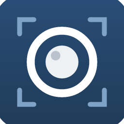

<div align="center">



# PhotoDesk

**An open-source, native image editor for macOS — layers, masks, type and real PSD files.**

</div>

PhotoDesk is a native desktop photo editor written entirely in Rust: egui/eframe UI on a wgpu GPU compositor. It opens and saves real PSD files and aims at full Photoshop-class editing — layers, masks, selections, brushes, filters, type — with native performance.

## Install

Build from source (Rust stable required):

```bash
cargo run --release -p photocraft -- image.psd
```

Package a macOS app bundle:

```bash
packaging/photodesk/make-app.sh
```

## Status

PhotoDesk v1 targets macOS. Windows and Linux builds are planned (the codebase is cross-platform).

## Credits & license

PhotoDesk is a fork of [PhotoCraft](https://github.com/storytold/photocraft) by the ArtCraft / storytold project, used under its dual **MIT OR Apache-2.0** license. See [LICENSE-MIT](LICENSE-MIT), [LICENSE-APACHE](LICENSE-APACHE), [NOTICE](NOTICE), [ATTRIBUTION.md](ATTRIBUTION.md) and [docs/photodesk/ACKNOWLEDGEMENTS.md](docs/photodesk/ACKNOWLEDGEMENTS.md). "ArtCraft" and "PhotoCraft" names and logos are trademarks of their owners and are not used by PhotoDesk.

PhotoDesk is maintained by Benjamin Sardar / PromotEdge. It is licensed under the same MIT OR Apache-2.0 terms as upstream.
